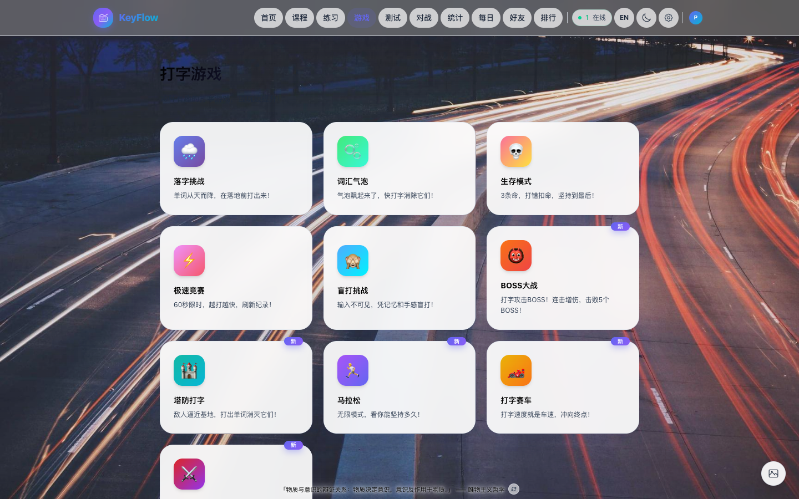
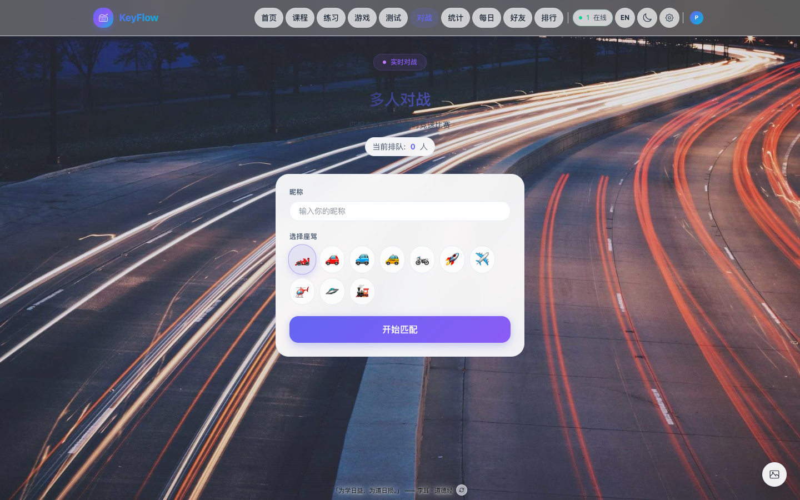
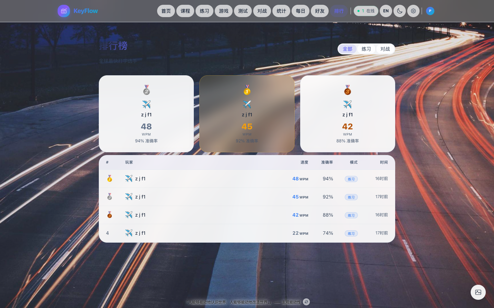
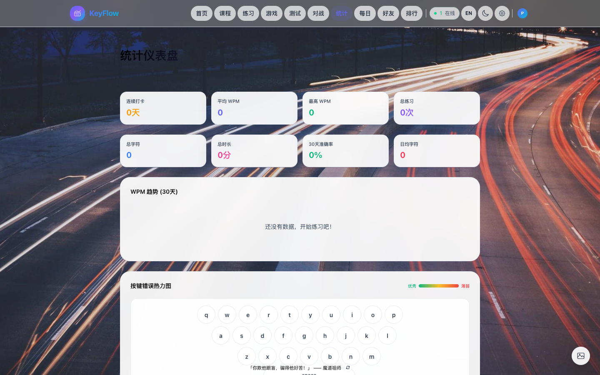
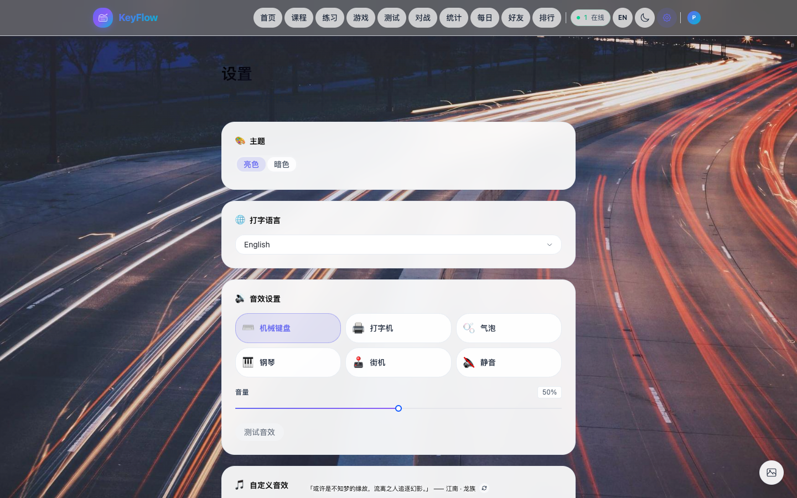

<p align="center">
  
</p>

<h1 align="center">KeyFlow - 在线打字竞速平台</h1>

<p align="center">
  <strong>从零基础到打字高手，渐进式课程 + 多人实时竞速 + 至臻打字体验</strong>
</p>

<p align="center">
  <a href="http://182.92.160.46">在线体验</a> ·
  <a href="#功能特性">功能特性</a> ·
  <a href="#截图展示">截图展示</a> ·
  <a href="#本地开发">本地开发</a> ·
  <a href="#部署指南">部署指南</a>
</p>

---

## 截图展示

### 练习模式 — 虚拟键盘 + 手指指引

<p align="center">
  
</p>

### 打字课程 — 28 节渐进式课程体系

<p align="center">
  
</p>

### 10 种打字游戏 — BOSS大战、塔防、赛车...

<p align="center">
  
</p>

### 多人对战 — Socket.IO 实时竞速

<p align="center">
  
</p>

### 排行榜

<p align="center">
  
</p>

### 统计仪表盘 — WPM趋势 + 按键热力图

<p align="center">
  
</p>

### 每日挑战

<p align="center">
  
</p>

### 设置 — 主题 / 音效 / 键盘布局

<p align="center">
  
</p>

### 移动端适配

<p align="center">
  
</p>

---

## 功能特性

### 核心功能
- **打字练习** — 英文 / 中文拼音，三种难度，随机或自定义文本
- **多人对战** — Socket.IO 实时匹配，最多 5 人同场竞技
- **课程系统** — 从 Home Row 到全键盘的 28 节渐进式课程
- **每日挑战** — 全服同一篇文本，每日排行
- **代码模式** — JavaScript / Python / Go 代码片段练习

### 打字游戏
- BOSS 大战、塔防、赛车、格斗、打字泡泡、盲打挑战、马拉松、生存、单词下落、极速赛车

### 数据与统计
- WPM 趋势折线图（30 天）
- 按键错误热力图（3D 键盘可视化）
- 成就徽章（30+）、等级系统、经验值
- 打字回放录制与播放
- 排行榜（练习 / 对战 / 全部）

### 社交
- 好友系统（好友码添加、在线状态）
- 私人房间对战

### 个性化
- 暗色 / 亮色双主题
- 6 种音效主题 + 自定义音效上传
- 背景音乐（Lo-Fi / 自然 / 雨声 / 白噪音 / 咖啡厅）
- 键盘布局（QWERTY / Dvorak / Colemak）
- 高清壁纸背景（60 秒轮换）
- 护眼模式、休息提醒

### 响应式设计
- 完整适配桌面、平板和手机端

---

## 技术栈

| 层级 | 技术 |
|------|------|
| **前端** | React 19 · TypeScript · Tailwind CSS 4 · Arco Design · Framer Motion |
| **后端** | Express 4 · Socket.IO 4 · TypeScript |
| **数据库** | SQLite (better-sqlite3) · WAL 模式 |
| **构建** | Vite 8 |
| **部署** | PM2 · Nginx |

---

## 项目结构

```
├── client/                     # React 前端
│   ├── src/
│   │   ├── components/         # 通用组件
│   │   │   └── games/          # 10 种打字游戏组件
│   │   ├── pages/              # 页面
│   │   ├── lib/                # 工具库
│   │   └── hooks/              # React Hooks
│   └── dist/                   # 构建产物
├── server/                     # Express 后端
│   └── src/
│       ├── db/                 # SQLite schema & queries
│       ├── socket/             # Socket.IO 事件处理
│       ├── texts/              # 文本数据
│       └── auth/               # OAuth 认证
├── deploy/                     # 部署配置
│   ├── nginx.conf              # Nginx 配置
│   ├── backup-db.sh            # 数据库备份脚本
│   ├── setup.sh                # 首次部署
│   └── update.sh               # 更新部署
├── ecosystem.config.cjs        # PM2 配置
└── data/                       # SQLite 数据库（运行时生成）
```

---

## 本地开发

### 环境要求

- Node.js >= 20
- npm >= 10

### 快速开始

```bash
# 克隆
git clone https://gitee.com/gitee_zhujf/key-flow.git
cd key-flow

# 安装依赖
npm run setup

# 启动开发模式（前后端同时启动）
npm run dev
```

- 前端: http://localhost:5173
- 后端: http://localhost:3001
- Vite 自动代理 `/api`、`/socket.io` 请求到后端

### 常用命令

| 命令 | 说明 |
|------|------|
| `npm run dev` | 开发模式（前后端） |
| `npm run build` | 构建前端 |
| `npm start` | 生产模式启动 |

---

## 部署指南

### 首次部署

```bash
# 上传到服务器
rsync -avz --exclude node_modules --exclude .git ./ root@SERVER:/opt/typing-race/

# 服务器上执行
bash /opt/typing-race/deploy/setup.sh
```

### 更新部署

```bash
rsync -avz --exclude node_modules --exclude .git --exclude data ./ root@SERVER:/opt/typing-race/
ssh root@SERVER 'bash /opt/typing-race/deploy/update.sh'
```

---

## 数据安全

| 措施 | 说明 |
|------|------|
| **自动备份** | 每天凌晨 3:00 自动备份数据库 |
| **安全方式** | SQLite `.backup` 命令，不锁库 |
| **压缩存储** | gzip 压缩，节省空间 |
| **保留 30 天** | 超期自动清理 |
| **PM2 守护** | 崩溃自动重启 |
| **开机自启** | systemd 集成 |

### 维护命令

```bash
pm2 status                          # 查看状态
pm2 logs typing-race                # 查看日志
pm2 restart typing-race             # 重启
/opt/typing-race/deploy/backup-db.sh    # 手动备份
```

---

## API 接口

| 端点 | 方法 | 说明 |
|------|------|------|
| `/api/texts/random` | GET | 随机文本 |
| `/api/texts/code` | GET | 代码文本 |
| `/api/leaderboard` | GET | 排行榜 |
| `/api/profile/:id` | GET/PUT | 用户档案 |
| `/api/score` | POST | 提交成绩 |
| `/api/stats/:id/daily` | GET | 每日统计 |
| `/api/stats/:id/keys` | GET | 按键统计 |
| `/api/daily-challenge` | GET | 今日挑战 |
| `/api/friends/:id` | GET | 好友列表 |
| `/api/replays` | GET/POST | 回放管理 |
| `/api/online-count` | GET | 在线人数 |

---

## 环境变量

```env
PORT=3001
NODE_ENV=production
OAUTH_REDIRECT_BASE=http://your-domain.com
GOOGLE_CLIENT_ID=xxx
GOOGLE_CLIENT_SECRET=xxx
```

---

## 许可证

MIT License
